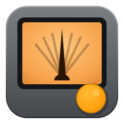
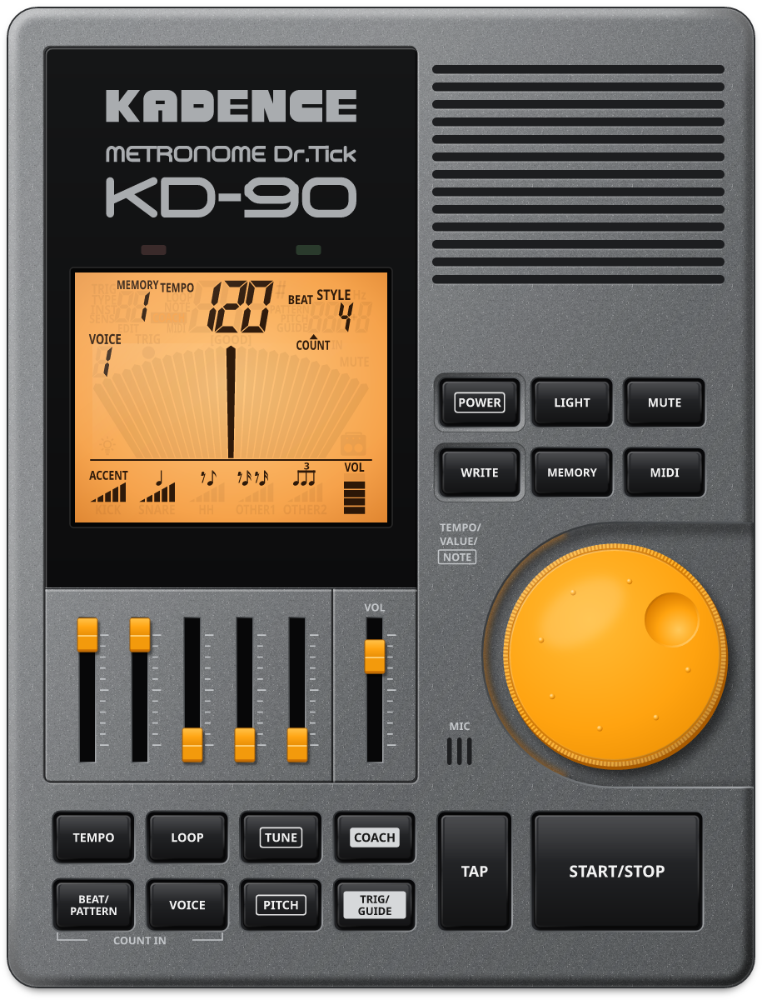
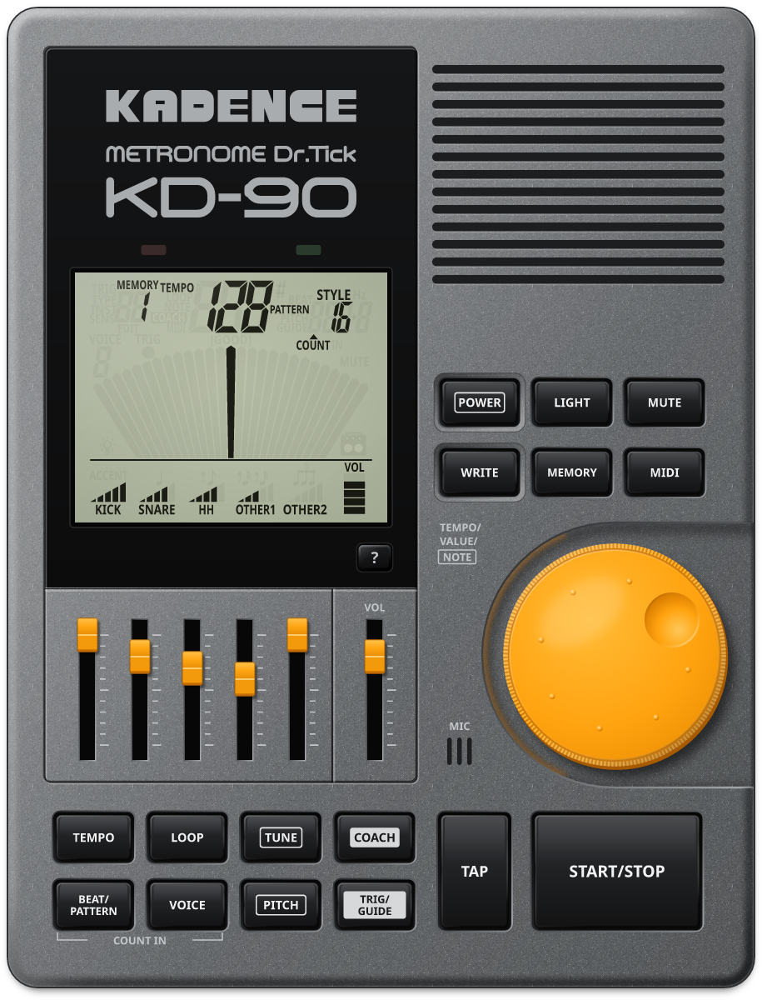

<div align="center">



# Kadence

**A rhythm-trainer metronome that looks, sounds and feels like a real device.**<br>
Backlit LCD, swinging pendulum, rhythm sliders and a clicking tempo dial, on your desktop.

[](LICENSE)




</div>

*Kadence* is a rhythm trainer for drummers, guitarists and every musician who practises with a
click. It is built like a piece of studio gear, down to the milled metal case, the button travel
and the orange glow of the LCD.

## Contents

- [Features](#features)
- [Installation](#installation)
  - [Flatpak](#flatpak)
  - [Debian and Ubuntu](#debian-and-ubuntu)
  - [Fedora and openSUSE](#fedora-and-opensuse)
  - [Other Linux](#other-linux)
  - [From source](#from-source)
  - [Add it to the application launcher](#add-it-to-the-application-launcher)
- [Using Kadence](#using-kadence)
  - [The panel](#the-panel)
  - [Tempo](#tempo)
  - [Beats and rhythms](#beats-and-rhythms)
  - [Drum patterns and voices](#drum-patterns-and-voices)
  - [Count-in](#count-in)
  - [Memories and Loop](#memories-and-loop)
  - [Rhythm Coach](#rhythm-coach)
  - [Reference tone](#reference-tone)
  - [Backlight and power](#backlight-and-power)
- [Keyboard shortcuts](#keyboard-shortcuts)
- [Settings file](#settings-file)
- [Troubleshooting](#troubleshooting)
- [Development](#development)
- [License](#license)

## Features

- 🥁 **Tempo 30 to 250 BPM**: set it with the clicking dial, the mouse wheel, the arrow keys, or by tapping.
- 🎚️ **Five rhythm sliders**: mix accents, quarter notes, eighths, sixteenths and triplets, like a drum machine for the metronome.
- 🎶 **Beats 1 to 9, and combined meters**: alternate two bar lengths, for example 3 + 2 for a 5/4 that you feel as two groups.
- 🪘 **30 drum patterns**: rock, shuffle, funk, jazz, Latin, waltz, march and more, with the sliders as a drum mixer.
- 🔔 **Three click voices**: a wind-up metronome, a beep and a sharp electronic click.
- 🎯 **Rhythm Coach** *(coming soon)*: *Time Check* listens through your microphone and shows whether you play ahead of or behind the beat. *Quiet Count* drops the click every other four bars to test your inner clock. *Gradual* and *Step Up/Down* move the tempo while you play.
- 💾 **50 memories**, and soon a **Loop** mode that plays them in a row: build a whole practice routine or a song's tempo map.
- 🎵 **Reference tone** from C2 to B6, with concert pitch from 438 to 445 Hz.
- ✨ **A device on your desktop**: a backlit LCD with segment ghosts, a swinging pendulum, buttons that sink when you press them, and a borderless window shaped like the case.
- 🪶 **Light**: one 11 MB program with no GUI toolkit. The GPU puts the panel on screen (Vulkan, Metal or DX12, and OpenGL on older hardware), and all sounds are synthesized.

## Installation

Every [release](https://github.com/bewzaalex/kadence/releases/latest) has packages for x86_64 PCs.
Download the one for your system from the release's **Assets** and install it as below.
The `.deb`, `.rpm` and `.tar.gz` packages are available from version 0.2.0 on.

### Flatpak

Works on any Linux distribution with Flatpak. It fetches the freedesktop runtime from Flathub if
you don't have it yet:

```sh
flatpak install --user kadence-*-x86_64.flatpak
```

To uninstall: `flatpak uninstall --user io.github.bewzaalex.kadence`.

### Debian and Ubuntu

```sh
sudo apt install ./kadence_*_amd64.deb
```

To uninstall: `sudo apt remove kadence`.

### Fedora and openSUSE

```sh
sudo dnf install ./kadence-*.x86_64.rpm        # Fedora
sudo zypper install ./kadence-*.x86_64.rpm     # openSUSE
```

To uninstall: `sudo dnf remove kadence` or `sudo zypper remove kadence`.

### Other Linux

The `.tar.gz` holds the program, which runs on any distribution with glibc 2.35 or newer
(2022 and later), with its icon and desktop entry:

```sh
tar -xzf kadence-*-x86_64-linux.tar.gz
./kadence-*-x86_64-linux/kadence
```

To add it to the application launcher, see [below](#add-it-to-the-application-launcher).

With every package, Kadence appears in the application launcher with its icon (the `.tar.gz` once
you add it). There are no automatic updates yet: to update, install the package from a newer
release the same way.

### From source

You need [Rust](https://rustup.rs) 1.85 or newer. On Linux you also need the ALSA development
files (`alsa-lib` on Arch and Gentoo, `libasound2-dev` on Debian and Ubuntu, `alsa-lib-devel`
on Fedora).

```sh
git clone https://github.com/bewzaalex/kadence.git
cd kadence
cargo run --release
```

The first build downloads the dependencies and takes a minute or two. After that you can start
the program directly with `./target/release/kadence`.

Linux is the main platform. The code builds for macOS and Windows too, but they aren't tested
yet, and on Windows the window still has a square frame (see [`docs/TODO.md`](docs/TODO.md)).

### Add it to the application launcher

The packages do this for you. For the `.tar.gz` or a build from source, install Kadence for your
user with its icon and launcher entry (on Wayland the desktop shows an application's icon only
once its desktop entry is installed).

From the unpacked `.tar.gz`:

```sh
cd kadence-*-x86_64-linux
install -Dm755 kadence ~/.local/bin/kadence
install -Dm644 -t ~/.local/share/applications io.github.bewzaalex.kadence.desktop
install -Dm644 -t ~/.local/share/icons/hicolor/scalable/apps io.github.bewzaalex.kadence.svg
```

From the source folder:

```sh
cargo build --release
install -Dm755 target/release/kadence ~/.local/bin/kadence
install -Dm644 -t ~/.local/share/applications assets/io.github.bewzaalex.kadence.desktop
install -Dm644 -t ~/.local/share/icons/hicolor/scalable/apps assets/icons/io.github.bewzaalex.kadence.svg
```

To uninstall, delete those three files.

## Using Kadence

### The panel

Click the buttons, drag the orange sliders and turn the dial. The dial clicks in steps, one value per click. Drag it in a circle near its edge, scroll
over it, or use the arrow keys.

**Settings stay open.** Pressing a setting's button (BEAT/PATTERN, VOICE, MEMORY, PITCH,
TRIG/GUIDE …) makes its label blink, and the dial then changes it. It stays open until you press
another button, even while the metronome plays: **START/STOP** and **LIGHT** don't close it
(only a pending **WRITE** is cancelled by START/STOP).
**TEMPO** and **TUNE** switch the screen instead: their value flashes twice, and the dial then
sets the tempo or the note.

The window has no frame. Drag the case anywhere outside the controls to move it, and use
<kbd>Ctrl</kbd>+<kbd>+</kbd> / <kbd>Ctrl</kbd>+<kbd>−</kbd> / <kbd>Ctrl</kbd>+<kbd>0</kbd> to resize it.
Run `kadence --decorations` if you prefer a normal window frame.

The LCD shows:

| Area | What it shows |
| --- | --- |
| Top left | The memory number, or the microphone sensitivity in Rhythm Coach |
| Centre | The tempo, or the note in Tune mode |
| Top right | The style: the beats per bar (4, or a combined bar like 3+4) or the pattern number, and the current count while playing |
| Middle | The pendulum, swinging with the beat |
| Bottom | The levels of the five rhythm sliders, and the master volume |

### Tempo

- Turn the dial to change the tempo by 1 BPM per click.
- Press **TAP** in time two to five times, and Kadence takes the tempo from your taps.
- Press **TEMPO** to go back to the plain metronome from any other mode.
- **START/STOP** starts and stops the click.

### Beats and rhythms

Press **BEAT/PATTERN**: the **BEAT** label blinks, and the dial chooses the beats per bar. It
runs from 1 to 9, then on to the combined bars 1+1, 1+2 … 9+9, and then back to 1. The first
beat of each bar is accented. A combined bar alternates two bar lengths, for example 3+2 for a
5/4 felt as 3 + 2. While playing, the digit above **COUNT** counts the beats of the bar.

The five sliders on the left mix the click:

| Slider | Plays |
| --- | --- |
| 1 | the accent on the first beat |
| 2 | quarter notes |
| 3 | eighth notes |
| 4 | sixteenth notes |
| 5 | triplets |

The **VOL** slider on the right is the master volume. **MUTE** silences the click while the
pendulum keeps swinging.

### Drum patterns and voices

<p align="center">
  
</p>

Press **BEAT/PATTERN** a second time to switch to the drum patterns: the **PATTERN** label blinks,
and the dial chooses one of the 30 patterns. Each further press switches between BEAT and
PATTERN. In a pattern the five sliders become a drum mixer: kick, snare, hi-hat and two extra
instruments, such as a ride cymbal, a clave or congas.

| Patterns | Style |
| --- | --- |
| 1–4 | 8-beat |
| 5–7 | 16-beat |
| 8–10 | Shuffle |
| 11, 12 | Funk |
| 13, 14 | Jazz |
| 15–19 | Blues, Techno, House, Country, Reggae |
| 20–25 | Clave 3-2, Clave 2-3, Salsa, Rumba, Bossa nova, Samba |
| 26–30 | Waltz, Tango, Mambo, Chachacha, March |

Press **VOICE** and turn the dial to choose the click sound:

1. a wooden wind-up metronome
2. an electronic beep
3. a short, sharp click that stays clear at high tempos

### Count-in

Press **BEAT/PATTERN** and **VOICE** together (or <kbd>C</kbd>) to turn the count-in on, and turn
the dial to set it from 1 to 8 beats. Kadence then counts you in with a distinct sound before
the first bar. Press both buttons again to turn it off.

### Memories and Loop

Kadence keeps 50 memories, each with the tempo, beat or pattern, voice and slider levels.

- **Save**: press **WRITE**, turn the dial to choose the memory number, and press **WRITE** again.
  **START/STOP** cancels.
- **Recall**: press **MEMORY** and turn the dial.
- **Loop** *(not available yet: it's still being tested, and the button only says so)*: press
  **LOOP** to play the memories in a row. To set how many bars a memory plays,
  choose it with **MEMORY** and the dial while Loop is stopped, then turn the dial to the number
  of bars. Memories set to 0 bars are skipped. Use it for a practice routine that speeds up, or
  for the tempo map of a song.

### Rhythm Coach

> **Not available yet.** The Rhythm Coach is still being tested; for now **COACH** and
> **TRIG/GUIDE** only say so. This is how it will work.

Press **COACH** to enter the Rhythm Coach, and press it again to cycle through its four exercises:

| Exercise | What it does |
| --- | --- |
| **Time Check** | Play along on a pad or your instrument. Kadence listens through the microphone, and the display shows each hit as behind the beat (left), ahead of it (right) or on it (centre, with **GOOD**). |
| **Quiet Count** | The click plays for four bars and goes nearly silent for the next four. Keep time through the quiet bars. |
| **Gradual Up/Down** | The tempo rises by 1 BPM every two beats up to 250 BPM, then falls back. Press **WRITE** at any moment to make the current tempo the top. |
| **Step Up/Down** | The same, but in steps of 5 BPM every four bars. |

For Time Check, **TRIG/GUIDE** sets the microphone sensitivity (1 to 16), and pressing it again
sets how strict the check is (1 to 3). If you have no microphone, click the **MIC** slots on the
panel or press <kbd>K</kbd> on each hit.

### Reference tone

Press **TUNE** for a reference tone. Turn the dial to choose the note from C2 to B6, and press
**START/STOP** (or **MUTE**) to play or stop it. **PITCH** sets concert A from 438 to 445 Hz.
**WRITE** stores the note and pitch in one of ten tone memories.

### Backlight and power

**LIGHT** switches the LCD backlight on and off, and Kadence remembers your choice. **POWER**
switches the display off and closes Kadence; everything you changed is already saved.

To restore the factory settings, hold **MEMORY** (or <kbd>E</kbd>) and press **POWER**
(or <kbd>P</kbd>). Kadence stops, resets every memory and setting, and keeps running.

The **LOOP**, **COACH**, **TRIG/GUIDE** and **MIDI** buttons only say that their function isn't available yet.

## Keyboard shortcuts

| Key | Action |
| --- | --- |
| <kbd>Space</kbd> or <kbd>Enter</kbd> | START/STOP |
| <kbd>↑</kbd> <kbd>→</kbd> / <kbd>↓</kbd> <kbd>←</kbd> | Turn the dial one click up / down |
| <kbd>T</kbd> | TAP |
| <kbd>B</kbd> / <kbd>V</kbd> | BEAT/PATTERN / VOICE |
| <kbd>C</kbd> | Count-in on/off |
| <kbd>M</kbd> | MUTE |
| <kbd>L</kbd> | LIGHT |
| <kbd>W</kbd> / <kbd>E</kbd> | WRITE / MEMORY |
| <kbd>1</kbd> … <kbd>7</kbd> | TEMPO, LOOP, TUNE, PITCH, COACH, TRIG/GUIDE, MIDI (LOOP, COACH, TRIG/GUIDE and MIDI aren't available yet) |
| <kbd>K</kbd> | A hit for Time Check |
| <kbd>P</kbd> | POWER: switch off and quit |
| <kbd>E</kbd> + <kbd>P</kbd> | Restore factory settings |
| <kbd>Ctrl</kbd>+<kbd>+</kbd> / <kbd>Ctrl</kbd>+<kbd>−</kbd> / <kbd>Ctrl</kbd>+<kbd>0</kbd> | Bigger / smaller / default window size |
| <kbd>Ctrl</kbd>+<kbd>Q</kbd> | Quit |

## Settings file

Memories, tone memories and the panel settings are saved as plain text in:

| System | File |
| --- | --- |
| Linux | `~/.config/kadence/settings.txt` |
| Flatpak | `~/.var/app/io.github.bewzaalex.kadence/config/kadence/settings.txt` |
| macOS | `~/Library/Application Support/kadence/settings.txt` |
| Windows | `%APPDATA%\kadence\settings.txt` |

Delete the file to start fresh, or use the factory reset above.

To start quickly, Kadence also keeps a drawn copy of the panel for each window size it has used
(a few MB each, at most three) in `~/.cache/kadence/`, or in
`~/.var/app/io.github.bewzaalex.kadence/cache/kadence/` for the Flatpak. It's safe to delete;
Kadence draws the panel again on the next start.

## Troubleshooting

<details>
<summary><b>No sound</b></summary>

Kadence plays through PipeWire or PulseAudio when one is running, and talks to ALSA directly
otherwise. If the terminal shows `kadence: no audio output (…)`, the message lists what each
audio system answered. The usual causes:

- The sound server isn't running: check with `pactl info`.
- Only ALSA is available and another program holds the sound card.

</details>

<details>
<summary><b>The taskbar shows a generic icon</b></summary>

On Wayland the icon comes from the installed desktop entry. Install it as described in
[Add it to the application launcher](#add-it-to-the-application-launcher).

</details>

<details>
<summary><b>Time Check doesn't react to my playing</b></summary>

Raise the sensitivity with **TRIG/GUIDE** and the dial, or move the microphone closer. Kadence
opens the microphone the first time you enter the Rhythm Coach; if it can't, the terminal says
why, and <kbd>K</kbd> or the **MIC** slots work as the pad instead.

</details>

## Development

```
src/
  main.rs            entry point and the --render snapshot tool
  dirs.rs            where settings and the cache are kept on each system
  ui/                app.rs (window and input), panel.rs (SVG artwork), render.rs (layers),
                     gpu.rs (puts the layers on screen with wgpu)
  device/            mod.rs (buttons, modes, dial, memories, LCD state), store.rs (settings file)
  audio/             mod.rs (audio handle), engine.rs (sequencer), synth.rs (voices and drums),
                     patterns.rs (drum patterns), output.rs (sound output), mic.rs (Time Check input)
assets/              fonts, case texture, panel lettering, icon, desktop entry, AppStream metainfo
design/              the HTML/SVG mockup the app was built from, earlier drafts, and logo/: the
                     panel lettering (lettering.js; `node design/logo/export.js` updates the app)
docs/                TODO.md (open work), RELEASING.md (how releases are made), screenshots
packaging/flatpak/   Flatpak manifest and crate list
.github/             the release workflow, which builds every package from a tag
research/gpu/        the spike that chose wgpu for drawing (wgpu vs glutin + glow, with measurements)
```

`cargo test` runs the sequencer tests. `kadence --render out.png [button … | dial:N …]` draws the panel
to a PNG without opening a window, after pressing the named buttons and turning the dial; the screenshots above are made
this way. Open work is listed in [`docs/TODO.md`](docs/TODO.md).

## License

Kadence is released under the [MIT License](LICENSE).
The Noto Sans fonts are under the [SIL Open Font License 1.1](assets/fonts/OFL.txt).
